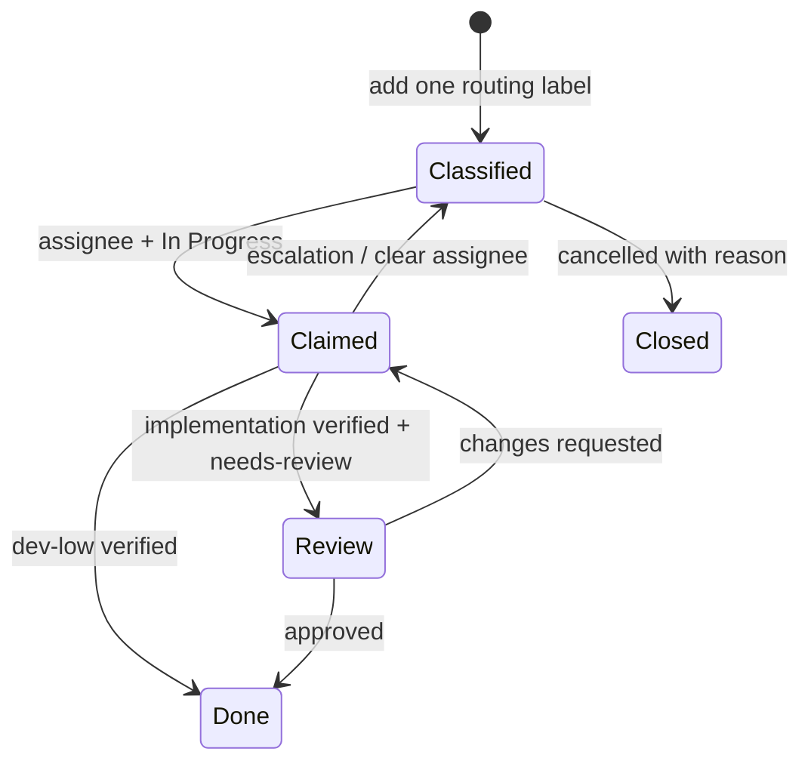

# Model routing

AI Hub uses Backlog.md labels as the durable routing contract. Labels stay in the repository, work in every CLI, and do not assume that every provider is online at the same time.

## Routing table

| Label | Primary provider | May also handle | Use for |
|---|---|---|---|
| `dev-high` | Claude (`@claude`) | — | Architecture, ambiguity, high-risk changes, complex debugging, final integration decisions |
| `dev-medium` | GPT (`@gpt`) | Claude | Normal feature work, bounded multi-file changes, established refactors, medium-complexity UI implementation |
| `dev-low` | DeepSeek (`@deepseek`) | Claude or GPT only when blocked | Mechanical edits, data/config updates, repetitive migrations, straightforward single-file changes |
| `art` | Gemini (`@gemini`) or GPT (`@gpt`) | — | Visual direction, UI composition, styling, assets, animation, image/video work |

Claude is the high-level developer. DeepSeek is the low-level developer. Gemini and GPT are peers for art; GPT is additionally the medium-level developer.

## Invariants

1. Every executable task has exactly one routing label.
2. Routing label describes the work. Assignee records the provider that claimed it.
3. A provider claims a task only when work begins; queued tasks stay unassigned.
4. A provider does not silently exceed its tier. It escalates the label, clears the assignee, records why, and returns the task to To Do.
5. A model change never requires copying task content into another system. The next provider reads the same Backlog task, plan, notes, acceptance criteria, and modified-file list.
6. Review routing is explicit: another Claude session reviews `dev-high`; Claude reviews `dev-medium`; Gemini and GPT peer-review each other's `art`; `dev-low` may finish directly after verification. GPT may review bounded implementation details of `dev-high`, but does not approve architecture.
7. `Closed` means intentionally not done. `Done` means implemented and verified.

## Task lifecycle



## Examples

Create routed work:

```bash
backlog task create "Refactor event lifecycle" -l dev-high
backlog task create "Add board API" -l dev-medium
backlog task create "Rename config keys" -l dev-low
backlog task create "Polish loading screen" -l art
```

Choose and claim work safely through AI Hub's helper (from the AI Hub repo, or put `bin/backlog-phase.mjs` on `PATH`):

```bash
node bin/backlog-phase.mjs next --provider gpt --path /absolute/project
node bin/backlog-phase.mjs claim TASK-12 --provider gpt --path /absolute/project
```

`next` returns one ready, unassigned To Do task sorted by priority then ordinal. `claim` uses an atomic local lock, validates status/readiness/tier, assigns `@gpt`, changes status to In Progress, then reads the task back to verify ownership. Use `--json` for automation and `--dry-run` to validate without writing. Do not claim with raw `backlog task edit`: two concurrent writers both return success and the last one silently wins.

Read the claimed task:

```bash
backlog task view TASK-12 --plain
```

Escalate without losing context:

```bash
backlog task edit TASK-12 \
  --remove-label dev-low \
  --add-label dev-medium \
  -a "" \
  -s "To Do" \
  --append-notes "Escalated: change crosses runtime and build-system boundaries"
```

Handoff for review:

```bash
backlog task edit TASK-12 \
  --add-label needs-review \
  -a "" \
  --append-notes "Implementation complete; smoke command and result: ..."
```

After review:

```bash
backlog task edit TASK-12 \
  --remove-label needs-review \
  -a @claude \
  --append-notes "Reviewed by @claude: approved; evidence: ..." \
  -s Done
```

## Why labels, not one project-level model

The routing label selects a provider family; it does not replace provider-specific reasoning-level rules. For example, a repository may still choose Claude Opus versus Sonnet inside `dev-high`. A sprint commonly mixes architecture, feature work, mechanical work, and art. A project-level provider would either overpay for simple tasks or route complex work to a weak model. Per-task labels keep the decision explicit and reviewable in Git.
